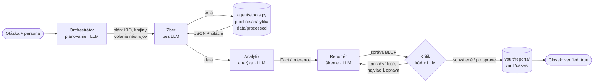

# Architektúra LiekRadaru

Tento súbor priebežne dopĺňame. Slúži ako podklad pre kapitolu 4 reportu.

## Vrstvy

1. **Dátová vrstva** (`pipeline/`, raz denne): stiahne dáta SÚKL, ŠÚKL a EMA, spáruje lieky CZ ↔ SK a vypočíta skóre rizika.
2. **Multiagentný systém** (`agents/`, na požiadanie): LangGraph + Gemini.
3. **Webová aplikácia** (`app.py`): Streamlit na Streamlit Community Cloud.

## Agenti a fázy cyklu CI

Multiagentný systém je graf v LangGraph (`agents/graph.py`) s modelom Gemini
(`langchain-google-genai`, model z `GEMINI_MODEL`, teraz `gemini-3.5-flash-lite`). Poradie agentov
kopíruje cyklus CI. Systémový prompt každého agenta tvorí celý `vault/AGENTS.md` (pravidlá, citácie,
mierka PHIA, červené čiary, formát BLUF) a krátky popis jeho roly. Čísla počítajú len nástroje nad
`pipeline.analytika`, model ich iba vyberá a interpretuje.

| Agent | Fáza CI | Rola | Nástroje a dáta |
| --- | --- | --- | --- |
| Orchestrátor (LLM) | Plánovanie | Z otázky a persony (výrobca / lekáreň) vyberie KIQ, krajiny, ATC prefix a najviac 6 volaní nástrojov. Výstup je štruktúrovaný (Pydantic), kód ho overí: povolené sú len nástroje zo zoznamu a platné ATC kódy a kódy liekov. | Zoznam nástrojov, otázka, persona |
| Zber (bez LLM) | Zber | Zavolá nástroje podľa plánu. Hodnotu `z_top_rizikove` nahradí dvoma najrizikovejšími liekmi z KIQ1, takže sa dá pokračovať náhradami alebo posunom. Výsledok prevedie na JSON (najviac 10 riadkov) a citácie zachová. Pri náhradách doplní pôvodný liek z registra a pri každom kandidátovi príznak, či má rovnakú liekovú formu. | `top_rizikove` (KIQ1), `detail_latky`, `posun_latky` (KIQ2), `nahrady` (KIQ3), `konkurenti` (KIQ4), `trhove_medzery` (KIQ5) nad `data/processed/*.parquet` |
| Analytik (LLM) | Analýza | Z výsledkov nástrojov spraví zistenia, fakty `[ID, Admiralty]` a úsudky (Odhadujeme… / Pravdepodobne…, mierka PHIA) oddelene. Pomenuje aj medzery v dátach. | JSON z nástrojov |
| Reportér (LLM) | Šírenie | Napíše správu BLUF po slovensky podľa sekcie 8 AGENTS.md pre zvolenú personu. Prvá veta BLUF má výraz PHIA a istotu. Ako náhrady uvádza len lieky s rovnakou liekovou formou, upozornenie o lekárovi píše ako samostatný riadok. Po vrátení od kritika správu opraví (najviac 1-krát). | Zistenia analytika, JSON z nástrojov, `vault/manifest_zdrojov.csv` |
| Kritik (kód + LLM) | Kontrola kvality (Lint) | Kód overí sekcie BLUF, citácie podľa manifestu (ID aj známka Admiralty, aj v zlúčenom tvare), citáciu pri každom fakte, začiatok úsudkov, výrazy PHIA v kľúčových úsudkoch aj v prvej vete BLUF, strop istoty bez nezávislého potvrdenia (najviac „pravdepodobné“, istota stredná), zakázané slová, skóre bez percent, náhrady inej liekovej formy a samostatné upozornenie o lekárovi. Overí aj čísla proti nástrojom (`agents/kontrola_cisel.py`): skóre lieku, kód lieku a jeho balenie, vlny a dni posunu. LLM posúdi obsah a či správa odpovedá na otázku. Pri probléme vráti správu reportérovi s presným rozdielom („v správe X, v dátach Y“). | Správa, JSON z nástrojov, manifest |
| Človek (analytik tímu) | Spätná väzba | Prečíta správu a Case Log a po overení nastaví `verified: true`. | `vault/reports/`, `vault/cases/` |

**Stav grafu:** `otazka`, `persona`, `plan`, `data`, `analyza`, `brief`, `kritika`, `pocet_oprav`,
`priebeh` (kroky agentov pre aplikáciu), `case_log` (čas UTC, agent, nástroj, vstup, výsledok v jednom riadku).

**Výstup:** `agents.graph.spusti(otazka, persona)` vráti pre Streamlit `brief`, `priebeh`, `case_log`,
`subory` (cesty k správe a Case Logu), `plan`, `kritika`, `schvalene` a `chyba`. Správa sa uloží do
`vault/reports/<YYYY-MM-DD>-<krátky-názov>.md` a Case Log do `vault/cases/<YYYY-MM-DD>-<krátky-názov>.md`,
obe s `verified: false`. Sekciu *AI use statement* napíše po kritikovi kód podľa Case Logu: všetkých
5 agentov, modely pri každom kroku, počet kôl opravy, výsledok kontroly a počet volaní modelu.
Ukážka: `.venv/bin/python -m agents.demo`.

**Limity bezplatnej úrovne Gemini (15 požiadaviek za minútu, 500 za deň):** jedna otázka potrebuje
4 volania modelu (orchestrátor, analytik, reportér, kritik), s opravou 6. `agents/llm.py` drží najviac
15 volaní za minútu a 6 úspešných volaní na otázku. Pri chybe 429 počká podľa odpovede servera,
pri 503 15 s, a skúsi to raz znova. Ak hlavný model vráti 503 aj po opakovaní, prepne sa na záložný
model `GEMINI_MODEL_FALLBACK` (predvolene `gemini-3.1-flash-lite`) a ten použije do konca otázky.
Case Log pri každom kroku uvádza model, ktorý krok spravil. Ak zlyhá aj záložný model, systém vráti
zrozumiteľnú chybu. Kľúč sa číta zo `st.secrets` alebo z premennej prostredia a nikam sa nezapisuje.
`LIEKRADAR_FAKE_LLM=1` vráti pevné odpovede, takže sa graf dá otestovať bez kľúča.
`LIEKRADAR_FAKE_503=n` navyše nasimuluje preťaženie hlavného modelu od n-tého volania.

## Externé dáta

Doplníme po audite dát (URL, formát, frekvencia, história).
