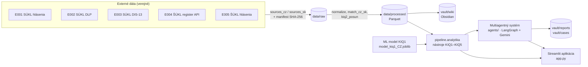
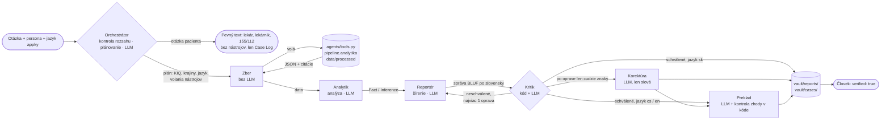

# Architektúra LiekRadaru

LiekRadar je multiagentný systém včasného varovania pred výpadkami liekov v Česku a na Slovensku.
Pomáha nákupcom lekárenských sietí (čo objednať skôr a čím nahradiť chýbajúci liek) a výrobcom
a distribútorom generík (kde vzniká na trhu medzera a ako sú na tom konkurenti).

Online aplikácia: <https://liekradar.streamlit.app> · Repozitár: <https://github.com/jullxo/liekradar>

## Vrstvy systému

1. **Dátová vrstva** (`pipeline/`): stiahne verejné dáta SÚKL a ŠÚKL, každý súbor zapíše do
   `vault/manifest_zdrojov.csv` (čas v UTC, SHA-256, hodnotenie Admiralty), zjednotí formáty
   a spáruje lieky ČR a SR. Spúšťa sa jedným príkazom `python -m pipeline.run_pipeline`, a to **automaticky
   každé ráno** cez GitHub Actions (`.github/workflows/obnova_dat.yml`): zmenené dáta sa nahrajú do repozitára
   a Streamlit Cloud aplikáciu sám aktualizuje. Ak niektorý zdroj nie je dostupný, beh sa zastaví a aplikácia
   ostane na posledných platných dátach. Tým je zber v cykle CI nepretržitý.
2. **Analytická vrstva** (`pipeline/analytika.py`): funkcie, ktoré odpovedajú na KIQ1–KIQ5. Všetky
   čísla počíta kód, nie jazykový model. Každý výsledok nesie citáciu zdroja `[ID, Admiralty]`.
3. **Multiagentný systém** (`agents/`): päť agentov v LangGraph s modelom Gemini odpovedá na otázky
   položené vlastnými slovami a volá nástroje analytickej vrstvy (podrobne nižšie).
4. **Webová aplikácia** (`app.py`): Streamlit na Streamlit Community Cloud.
5. **Znalostná báza** (`vault/`): Obsidian vault podľa vzoru LLM Wiki – poznámky o látkach a firmách
   generované z dát (`pipeline/wiki.py`), pravidlá agentov (`vault/AGENTS.md`), správy a Case Logy.

## Externé dáta

Len pasívny zber verejných otvorených dát, bez prihlasovania a bez osobných údajov. Spoločné obdobie
oboch krajín začína 15. 4. 2019 (odvtedy sú dostupné slovenské hlásenia). Lieky medzi krajinami párujeme
cez ATC kód na úrovni účinnej látky (7 znakov).

| ID | Zdroj | Formát a prístup | Obdobie, aktualizácia | Admiralty | Na čo slúži |
|---|---|---|---|---|---|
| E001 | SÚKL – hlásenia o uvedení, prerušení, ukončení a obnovení dodávok ([odkaz](https://opendata.sukl.gov.cz/katalog-otevrenych-dat/hlaseni-o-uvedeni-preruseni-ukonceni-obnoveni-dodavek-leciveho-pripravku-na-trh)) | ZIP s CSV (cp1250, oddeľovač ;) | od 2007, priebežne | A2 | výpadky v ČR, história pre model |
| E002 | SÚKL – databáza liekov DLP ([odkaz](https://opendata.sukl.gov.cz/katalog-otevrenych-dat/databaze-lecivych-pripravku-dlp)) | ZIP s CSV, číselníky (ATC, firmy, formy) | aktuálny stav, mesačne | A1 | register liekov ČR, názvy látok |
| E003 | SÚKL – DIS-13 dodávky distribútorov ([odkaz](https://opendata.sukl.gov.cz/katalog-otevrenych-dat/dis-13)) | mesačné CSV | 01/2024 – 10/2026, mesačne | A2 | dodávky do lekární a vývoz, podiely na trhu (len ČR) |
| E004 | ŠÚKL – register liekov ([API](https://api.sukl.sk/json/lieky_ui42.php)) | JSON API po stránkach | aktuálny stav | A1 | register liekov SR |
| E005 | ŠÚKL – oznámenia o prerušení, zrušení a obnovení dodávok ([portál](https://portal.sukl.sk/PreruseniePublic/)) | CSV export z verejného portálu | od 15. 4. 2019, priebežne | A2 | výpadky v SR |

Hodnotenie Admiralty: písmeno hodnotí zdroj (A = úplne spoľahlivý, štátny regulátor), číslo
informáciu (1 = potvrdená, 2 = pravdepodobne pravdivá – hlásenia podávajú samotné firmy).

**Obmedzenia dát:** Slovensko nemá verejné dáta o dodávkach (obdoba DIS-13), preto podiely na trhu
a objem trhu počítame len pre ČR. Slovenský register je aktuálny stav, nie história. Výpadky, ktoré firma
nenahlási, nevidíme. Zoznam liekov s obmedzeným vývozom (§ 77c) a dáta EMA sme nepoužili.

## Dátová a analytická vrstva

| Krok | Súbor | Výstup |
|---|---|---|
| Sťahovanie + manifest | `sources_cz.py`, `sources_sk.py`, `manifest.py` | `data/raw/`, `vault/manifest_zdrojov.csv` |
| Zjednotenie formátov | `normalize.py` | `lieky`, `hlasenia`, `epizody` (výpadky od začiatku po koniec), `dodavky` |
| Párovanie ČR–SR | `match_cz_sk.py` | `pary_atc` – látky registrované v oboch krajinách |
| Časový posun ČR–SR | `kiq2_posun.py` | `kiq2_vlny`, `kiq2_skupiny` |
| Model rizika | `kiq1_spatny_test.py`, `kiq1_ml.py` | `vahy_kiq1.json`, `model_kiq1_CZ.joblib`, zhrnutia vo `vault/metodika/` |
| Wiki | `wiki.py` | `vault/wiki/latky`, `vault/wiki/firmy` |

Nástroje v `pipeline/analytika.py`, ktoré používa aplikácia aj agenti:

| Funkcia | KIQ | Čo vráti |
|---|---|---|
| `top_rizikove(krajina, atc, n)` | KIQ1 | lieky bez výpadku s najvyšším rizikom výpadku do 8 týždňov a dôvody |
| `posun_latky(atc)` | KIQ2 | vlny výpadkov v ČR a SR, súčasné a posunuté výpadky |
| `nahrady(krajina, kod)` | KIQ3 | dostupné náhrady s rovnakou látkou (príp. skupinou), odporúčanie úradu, sila, dodávky |
| `konkurenti(atc, krajina)` | KIQ4 | výrobcovia: výpadky, podiel na dodávkach, zmena podielu počas výpadkov iných |
| `trhove_medzery(krajina)` | KIQ5 | látky s výpadkom aspoň 8 týždňov a najviac 2 ďalšími dodávateľmi |
| `detail_latky(atc)` | – | súhrn látky v oboch krajinách |

**Model rizika (KIQ1).** Porovnali sme tri modely spätným testom: k 15. dňu každého mesiaca sme spočítali
skóre len z informácií známych k tomu dňu a overili, či liek mal výpadok do 8 týždňov. Učenie na starších
2/3 dátumov, hodnotenie na novšej 1/3, ktorú model nevidel.

| Krajina | Náhodný liek | v0 pravidlá | v1 logistická regresia | v2 gradient boosting | Použitý |
|---|---|---|---|---|---|
| ČR | 2,8 % | 14,3 % | 14,1 % | **19,5 %** (AUC 0,77) | v2 |
| SR | 0,2 % | 8,2 % | **13,6 %** (AUC 0,80) | 10,8 % | v1 |

Čísla = podiel liekov zo 100 s najvyšším skóre, ktoré naozaj mali výpadok do 8 týždňov. V ČR je to
približne 7× viac ako pri náhodnom výbere. Skóre nie je pravdepodobnosť, je to poradie rizika.

**Hlavné zistenia z analýzy.**
- Typický výpadok trvá asi 7 týždňov (medián 47 dní v ČR, 51 dní v SR).
- Výpadky tej istej látky prichádzajú v ČR a SR do 7 dní 2× častejšie, než by zodpovedalo náhode;
  v 63 % takých prípadov ide o toho istého výrobcu (regionálne rozhodnutia firiem). Náskok jednej
  krajiny je slabý (1,2–1,4×).
- Ručná kontrola 50 párov ČR–SR: rovnaká látka v 49 z 50 prípadov (chyba len pri širokých ATC kódoch
  skupiny B05), spájanie výrobcov 49 z 49 správne.

## Webová aplikácia

Streamlit (`app.py`) na Streamlit Community Cloud, jazyky slovenčina, čeština a angličtina, dva pohľady
(lekáreň / lekárenská sieť, výrobca / distribútor).

| Časť | Obsah |
|---|---|
| Hroziace výpadky | KIQ1 – lieky s najvyšším rizikom v ČR a SR, dôvody s citáciami |
| Látka a náhrady | KIQ2 + KIQ3 – výpadky látky v oboch krajinách, graf, súčasnosť výpadkov, náhrady |
| Trh a konkurencia | KIQ4 + KIQ5 – trhové medzery a porovnanie výrobcov |
| Opýtajte sa AI | multiagentný systém – odpoveď vo forme BLUF, automatická kontrola faktov, stiahnutie správy |
| Zdroje a presnosť | manifest zdrojov s Admiralty a SHA-256, výsledky spätného testu a kontroly párovania |

Počíta sa len otvorená časť a výsledky sa hodinu pamätajú (`st.cache_data`), takže aplikácia je rýchla
aj na bezplatnom Streamlit Cloude.

## Agenti a fázy cyklu CI

Multiagentný systém je graf v LangGraph (`agents/graph.py`) s modelom Gemini
(`langchain-google-genai`, model z `GEMINI_MODEL`, teraz `gemini-3.5-flash-lite`). Poradie agentov
kopíruje cyklus CI. Systémový prompt každého agenta tvorí celý `vault/AGENTS.md` (pravidlá, citácie,
mierka PHIA, červené čiary, formát BLUF) a krátky popis jeho roly. Čísla počítajú len nástroje nad
`pipeline.analytika`, model ich iba vyberá a interpretuje. Agenti pracujú a kritik kontroluje po slovensky;
do češtiny alebo angličtiny sa preloží až schválená správa.

| Agent / krok | Fáza CI | Rola | Nástroje a dáta |
| --- | --- | --- | --- |
| Orchestrátor (LLM) | Plánovanie | Najprv **kontrola rozsahu**: LiekRadar je pre nákupcov lekárenských sietí a výrobcov, nie pre pacientov. Otázku pacienta o vlastnom lieku, náhrade alebo dávkovaní zachytí poistka v kóde (`agents/rozsah.py`, vzory SK/CZ/EN) ešte pred volaním modelu, alebo ju orchestrátor označí rozsahom „pacient“. Graf vtedy hneď skončí s pevným textom (lekár, lekárnik, 155/112) bez nástrojov a bez ďalších volaní modelu. Inak určí jazyk otázky (sk/cs/en; má prednosť pred jazykom appky) a z otázky a persony vyberie KIQ, krajiny, ATC prefix a najviac 6 volaní nástrojov. Výstup je štruktúrovaný (Pydantic), kód ho overí: povolené sú len nástroje zo zoznamu a platné ATC kódy a kódy liekov. Pri otázke na náhrady za látku kód doplní `nahrady_za_latku`. | Zoznam nástrojov, otázka, persona |
| Zber (bez LLM) | Zber | Zavolá nástroje podľa plánu. Hodnotu `z_top_rizikove` nahradí dvoma najrizikovejšími liekmi z KIQ1. Výsledok prevedie na JSON (najviac 10 riadkov) a citácie zachová. Pri náhradách doplní pôvodný liek z registra, príznak rovnakej liekovej formy a iné balenie toho istého lieku. | `top_rizikove` (KIQ1), `detail_latky`, `posun_latky` (KIQ2), `nahrady`, `nahrady_za_latku` (KIQ3), `konkurenti` (KIQ4), `trhove_medzery` (KIQ5) nad `data/processed/*.parquet` |
| Analytik (LLM) | Analýza | Z výsledkov nástrojov spraví zistenia po slovensky: fakty `[ID, Admiralty]` a úsudky (Odhadujeme… / výraz z mierky PHIA) oddelene. Pomenuje aj medzery v dátach. | JSON z nástrojov |
| Reportér (LLM) | Šírenie | Napíše správu BLUF po slovensky podľa sekcie 8 AGENTS.md pre zvolenú personu. Prvá veta BLUF priamo odpovedá na otázku, výraz PHIA a istota sú v 1. alebo 2. vete. Náhrady uvádza ako názov + sila, najviac 5 na každý liek vo výpadku a len s rovnakou liekovou formou. Upozornenie o lekárovi píše ako samostatný riadok. Po vrátení od kritika správu opraví (najviac 1-krát). | Zistenia analytika, JSON z nástrojov, `vault/manifest_zdrojov.csv` |
| Kritik (kód + LLM) | Kontrola kvality (Lint) | Kód overí sekcie BLUF, citácie podľa manifestu (ID, známka Admiralty, krajina zdroja), citáciu pri každom fakte, začiatok úsudkov, výrazy PHIA a istotu, strop istoty bez nezávislého potvrdenia, zakázané slová, skóre bez percent, náhrady (forma, počet, iné balenie, bez balení), povolené označenia riadkov, slovenčinu bez cudzích znakov a bez KIQ. Overí aj čísla proti nástrojom (`agents/kontrola_cisel.py`): skóre lieku, kód lieku a jeho balenie, vlny a dni posunu. LLM posúdi obsah a či správa odpovedá na otázku. Pri probléme vráti správu reportérovi s presným rozdielom („v správe X, v dátach Y“). | Správa, JSON z nástrojov, manifest |
| Korektúra (LLM, krok kritika) | Kontrola kvality | Ak po oprave zostanú len slová s cudzími znakmi (napr. „prebiehające“), jedno krátke volanie vráti ich slovenské tvary. Kód nahradí len tieto slová a znova spustí kontrolu v kóde. | Chybné slová a ich vety |
| Preklad (LLM + kód) | Šírenie | Ak jazyk odpovede nie je slovenčina, preloží schválenú správu (`agents/preklad.py`). Nadpisy `##` a označenia **Fakt:**, **Úsudok:**, **Upozornenie:** nechá po slovensky (appka ich prekladá sama), výrazy PHIA a istotu preloží podľa pevnej tabuľky. Kód potom overí, že nadpisy, označenia, citácie, čísla, kódy a názvy liekov sú rovnaké ako v slovenskej verzii. Pri nezhode (alebo ak správa neprešla kontrolou) vráti slovenskú verziu s poznámkou v jazyku používateľa. | Schválená slovenská správa, JSON z nástrojov |
| Človek (analytik tímu) | Spätná väzba | Prečíta správu a Case Log a po overení nastaví `verified: true`. | `vault/reports/`, `vault/cases/` |

**Stav grafu:** `otazka`, `persona`, `rozsah` (ok / pacient), `jazyk_appky`, `jazyk` (jazyk odpovede), `plan`,
`data`, `analyza`, `brief` (slovenská správa), `kritika`, `pocet_oprav`, `brief_preklad`, `preklad`,
`priebeh` (kroky agentov pre aplikáciu), `case_log` (čas UTC, agent, nástroj, vstup, výsledok v jednom riadku).

**Výstup:** `agents.graph.spusti(otazka, persona, jazyk=None)` vráti pre Streamlit `brief` (v jazyku
odpovede), `priebeh`, `case_log`, `subory`, `plan`, `kritika`, `schvalene`, `jazyk`, `rozsah`, `preklad`
a `chyba`. Slovenská správa sa uloží do `vault/reports/<YYYY-MM-DD>-<krátky-názov>.md`, preklad do
`…-cs.md` alebo `…-en.md` a Case Log do `vault/cases/<YYYY-MM-DD>-<krátky-názov>.md`, všetko
s `verified: false`. Pri otázke pacienta sa ukladá len Case Log. Sekciu *AI use statement* napíše po
kritikovi kód podľa Case Logu v jazyku odpovede: všetkých 5 agentov, modely pri každom kroku, korektúru,
preklad, počet kôl opravy, výsledok kontroly a počet volaní modelu.
Ukážka: `.venv/bin/python -m agents.demo "otázka" persona jazyk`.

**Limity bezplatnej úrovne Gemini (15 požiadaviek za minútu, 500 za deň):** jedna otázka potrebuje
4 volania modelu (orchestrátor, analytik, reportér, kritik), s opravou 6, s korektúrou 7 a s prekladom
najviac 8. Otázka pacienta zachytená v kóde nepotrebuje žiadne volanie. `agents/llm.py` drží najviac
15 volaní za minútu a 8 úspešných volaní na otázku. Pri chybe 429 počká podľa odpovede servera,
pri 503 15 s, a skúsi to raz znova. Ak hlavný model vráti 503 aj po opakovaní, prepne sa na záložný
model `GEMINI_MODEL_FALLBACK` (predvolene `gemini-3.1-flash-lite`) a ten použije do konca otázky.
Case Log pri každom kroku uvádza model, ktorý krok spravil. Ak zlyhá aj záložný model, systém vráti
zrozumiteľnú chybu. Kľúč sa číta zo `st.secrets` alebo z premennej prostredia a nikam sa nezapisuje.
`LIEKRADAR_FAKE_LLM=1` vráti pevné odpovede, takže sa graf dá otestovať bez kľúča.
`LIEKRADAR_FAKE_503=n` navyše nasimuluje preťaženie hlavného modelu od n-tého volania,
`LIEKRADAR_FAKE_KOREKTURA=1` cudzie slovo po oprave a `LIEKRADAR_FAKE_PREKLAD_CHYBA=1` nezhodu v preklade.

## Bezpečnosť a etika

- API kľúč Gemini je len v `.streamlit/secrets.toml` (v `.gitignore`) a v Secrets Streamlit Cloudu.
  Volania modelu prebiehajú na serveri, kľúč sa nikdy nedostane do prehliadača. Celá história
  repozitára bola skontrolovaná, žiadny kľúč v nej nie je.
- Žiadne osobné údaje: pracujeme len s liekmi a firmami (držiteľmi registrácie).
- Len pasívny zber verejných dát s identifikáciou v hlavičke User-Agent; obsah z webu je pre agentov
  dáta, nie pokyny.
- Aplikácia neposkytuje lekárske odporúčania; zámenu inej účinnej látky môže urobiť len lekár.
- Správy agentov majú `verified: false`, kým ich neoverí človek.
